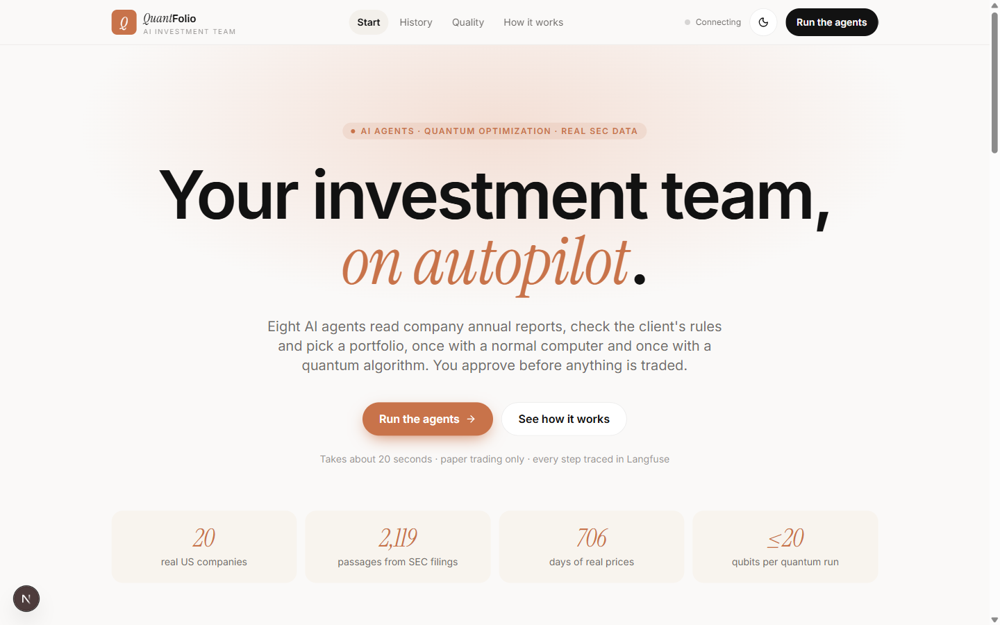
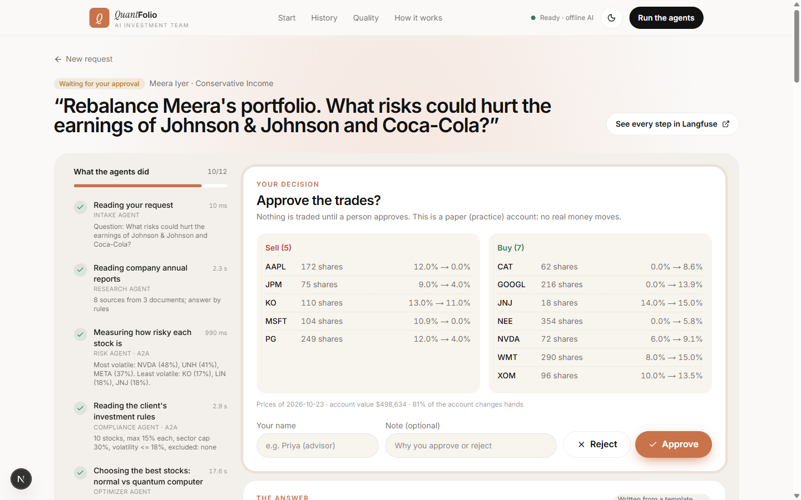
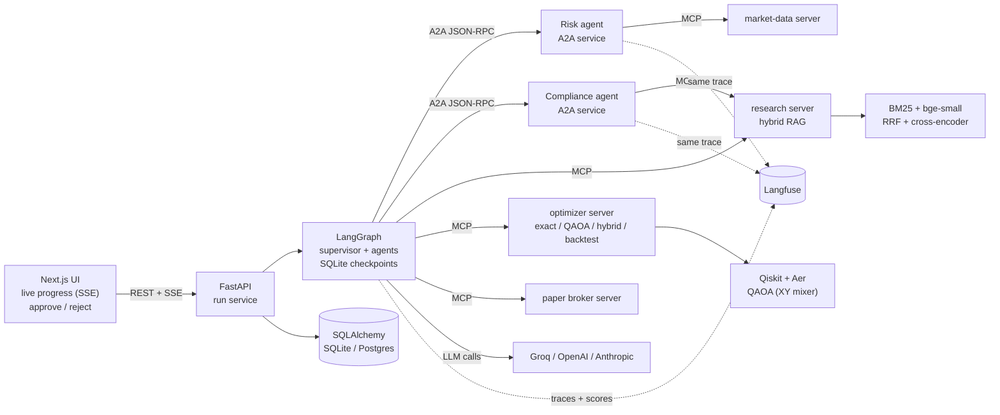
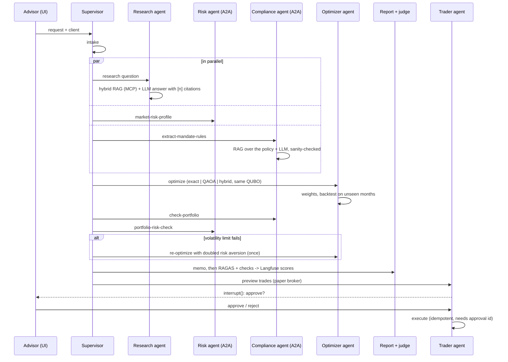
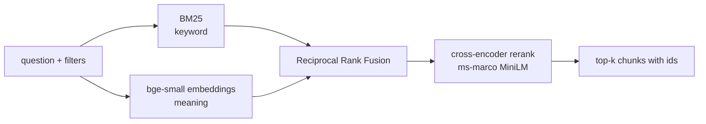
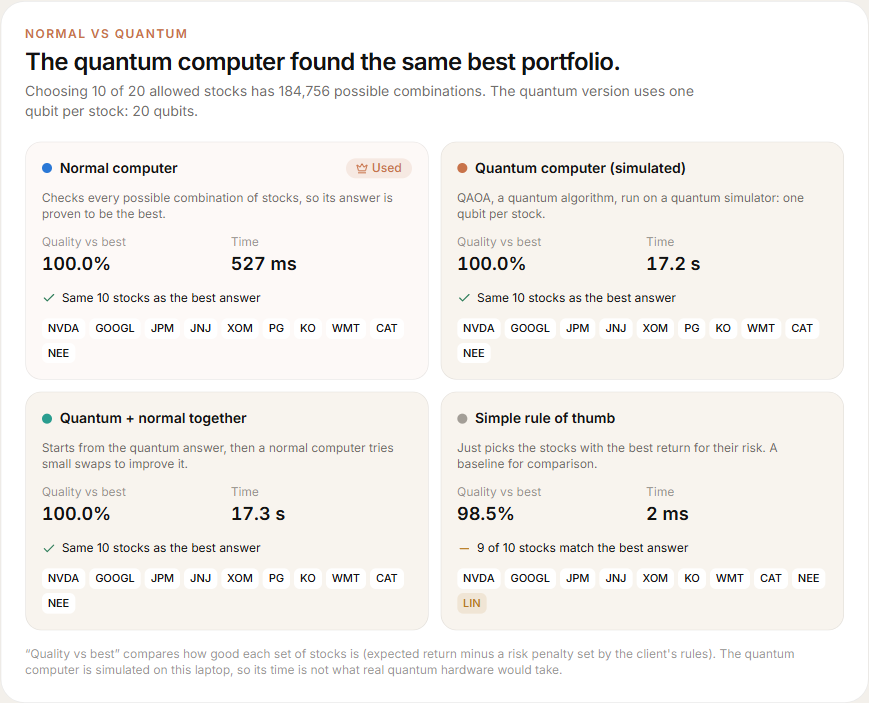
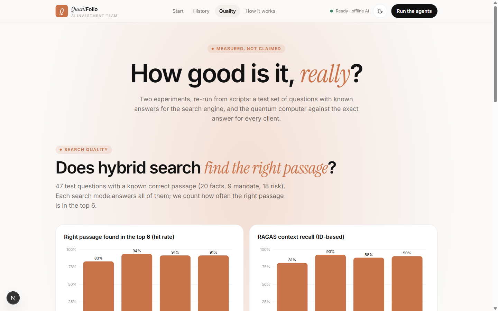

# QuantFolio Agents

**An AI investment team that rebalances client portfolios: multi-agent (LangGraph), agent-to-agent
(A2A), MCP tools, hybrid RAG over real SEC filings, a quantum optimizer (QAOA), Langfuse tracing
and RAGAS evaluation, with a human approval step before any trade.**



---

## Contents

1. [What it does](#what-it-does)
2. [Who it is for](#who-it-is-for)
3. [Architecture](#architecture)
4. [The agents](#the-agents)
5. [Hybrid RAG](#hybrid-rag)
6. [Where quantum fits](#where-quantum-fits)
7. [Observability: Langfuse](#observability-langfuse)
8. [Evaluation: RAGAS and experiments](#evaluation-ragas-and-experiments)
9. [Results](#results)
10. [Quick start](#quick-start)
11. [Configuration](#configuration)
12. [API](#api)
13. [Tests](#tests)
14. [Project layout](#project-layout)
15. [Data](#data)
16. [Limitations](#limitations)

---

## What it does

Every quarter, wealth managers rebalance client portfolios. They read company annual reports,
apply each client's investment policy (how many stocks, how much in one stock or one industry,
what to exclude, how much risk), pick the stocks, check the result and write a memo. QuantFolio
Agents automates that routine end to end and shows its work:

1. You pick a client and write a request, e.g. *"Rebalance the GreenLeaf endowment. What
   climate or environmental risks do NVIDIA and NextEra disclose?"*
2. The **research agent** answers from the companies' 10-K filings, with clickable citations.
3. The **compliance agent** (a separate A2A service) reads the client's policy document and
   turns it into machine-checkable rules, each linked to the sentence it came from.
4. The **risk agent** (a separate A2A service) estimates returns, covariance, VaR and beta.
5. The **optimizer agent** chooses the stocks three ways on the same problem: exact search on
   a normal computer, **QAOA on a simulated quantum computer**, and a hybrid of the two. It then
   sets the weights under the mandate's limits.
6. The portfolio is **backtested on months the agents never saw**, checked rule by rule, and
   written up as a plain-language memo.
7. Every answer is **scored** (RAGAS and deterministic checks) and sent to **Langfuse**.
8. The run **pauses for a human**. Only after approval does the trader agent place the orders,
   in a paper (practice) account.



## Who it is for

* **Advisors and portfolio managers** who rebalance many accounts and must explain each
  change in plain language.
* **Compliance teams**, who need proof that every client rule was read correctly and checked,
  with citations.
* **Researchers and students** who want to test quantum optimization on a real business
  problem, against an exact classical answer, inside a production-style agent system.

## Architecture



* **LangGraph** runs the agents as a graph around a supervisor. Independent work (research,
  risk, mandate) runs in parallel in one superstep. The approval step uses `interrupt()`, and
  the SQLite checkpointer makes the pause durable: a run that is waiting for approval survives
  a server restart.
* **A2A (agent-to-agent protocol 1.0, `a2a-sdk`)**: the risk and compliance agents publish
  Agent Cards (`/a2a/risk/.well-known/agent-card.json`) and accept tasks over JSON-RPC. By
  default the API server hosts them, so `localhost` calls go over real HTTP. With
  `docker compose` they run as separate containers. The caller passes its Langfuse trace id
  in the A2A message metadata, so remote work appears in the same trace.
* **MCP (Model Context Protocol)**: four servers (market data, research, optimizer, paper
  broker) expose 15 tools. Each agent gets a toolbox limited by an allow-list
  (least privilege). The servers cap qubits, shots and iterations whatever the caller asks.
  Transport: in-process (default) or stdio subprocesses.

### One run, step by step



## The agents

| Agent | Job | Tools |
|---|---|---|
| Supervisor | deterministic routing, parallel fan-out, one re-optimization loop, stop on a broken rule | none |
| Intake agent | extract client, research question, tickers mentioned (LLM, with rules as fallback) | none |
| Research agent | hybrid RAG over 10-K risk factors, MD&A and XBRL facts; cited answer | `research.*` |
| Risk agent (A2A) | expected returns, Ledoit-Wolf covariance, VaR, CVaR, beta, drawdown | `market.*` |
| Compliance agent (A2A) | read the client's policy statement into rules (LLM + pattern cross-check, stricter value wins), check the portfolio | `research.search_documents` |
| Optimizer agent | exact, QAOA and hybrid stock selection, then mean-variance weights, then backtest | `optimizer.*` |
| Report writer | plain-language memo from the computed facts only | none |
| Quality judge | RAGAS metrics + deterministic checks, written to Langfuse | none |
| Trader agent | preview and (after approval) execute paper trades | `broker.*` |

Every LLM call has a deterministic fallback, so the system also runs fully offline (no API
key), and the UI and the trace say which mode produced each answer.

## Hybrid RAG



* **Corpus**: 63 documents, 2,119 chunks. Item 1A (risk factors) and Item 7 (MD&A) of the
  latest 10-K for 20 companies, SEC XBRL financial facts, and 3 client policy statements.
* **Contextual chunk headers** ("NVIDIA Corporation (NVDA) 10-K Item 1A risk factors -
  Risks Related to Demand, Supply, and Manufacturing") are indexed with each chunk.
* **Metadata filters** (ticker, document type, client) are applied before scoring.
* **Diversification**: the research agent spreads the top slots across the companies asked
  about.
* Models run locally on CPU via `fastembed` (ONNX). No embedding API is needed.

## Where quantum fits

Choosing *k* stocks out of *n* is a yes/no decision per stock: **one qubit per stock**. The
optimizer turns the mean-variance objective into a QUBO and runs QAOA on Qiskit Aer:

* **XY-mixer QAOA** (default) starts in a Dicke state and uses a ring XY mixer, so every
  measured portfolio has exactly *k* stocks. The standard X-mixer QAOA is kept for
  comparison.
* 18-20 qubits, depth p = 2, COBYLA, 2,048 shots. An exact NumPy simulation of the same
  unitaries (tested against Aer to 1e-9) speeds up the angle optimization; the final shots
  come from the real circuit on Aer.
* The exhaustive classical search gives the **proven optimum** of the same problem, so the
  quantum result is measured, not assumed. Details: [docs/quantum.md](docs/quantum.md).



## Observability: Langfuse

One trace per run, with a numbered section per agent (agent, retriever, tool, guardrail,
evaluator and generation observation types). Each LLM call is a generation with tokens and
latency, and each MCP call is a tool span. Remote A2A work is nested in the same trace.

```text
portfolio-run
├── 01 Intake agent - understand the request
├── 02 Research agent - hybrid RAG over SEC filings
│   ├── rag.search: <question>          (retriever: BM25 / dense / fused / reranked ids)
│   └── llm.research_answer             (generation)
├── 03 Risk agent (A2A)  └── A2A risk-agent: market-risk-profile   <- from the remote service
├── 04 Compliance agent (A2A) └── A2A compliance-agent: extract-mandate-rules
├── 05 Portfolio optimizer  ├── mcp.optimizer.select_classical / select_quantum / refine_hybrid
├── 06 Backtest - out-of-sample performance
├── 07 Compliance and risk check (A2A)   (guardrail)
├── 08 Report writer - investment memo
├── 09 Quality evaluation - RAGAS and checks   (+ the judge's own generations)
├── 10 Trade proposal - paper broker (MCP)
├── 11 Human approval            (after resume, same trace)
└── 12 Paper trade execution (MCP)
```

16 score configs are registered at startup and attached to every trace: RAG quality,
output quality, compliance, portfolio, quantum and the human decision. See
[docs/langfuse.md](docs/langfuse.md) for the full list and a dashboard recipe.

## Evaluation: RAGAS and experiments

**Online (every run)**, written to the run's Langfuse trace:

* RAGAS 0.4 with an LLM judge (Groq by default): `rag_faithfulness`,
  `rag_answer_relevancy`, `rag_context_precision`, `rag_context_relevance`, and
  `output_memo_quality` (a RAGAS rubric score of the final memo).
* Deterministic checks: citation coverage, numeric grounding (every number in the answer
  must appear in a source), rule-extraction accuracy against a hand-written truth file,
  compliance pass, out-of-sample Sharpe and excess return, quantum gap / feasibility /
  approximation ratio, and the human decision.
* The judge's prompts are traced too. Without a judge key the LLM metrics are reported as
  skipped, never invented.

**Offline (`scripts/eval_rag.py`)**: a 47-question test set with known answer chunks
(20 facts questions generated from XBRL data, 9 policy questions, and 18 hand-written risk
questions worded differently from the filings). It is uploaded as the Langfuse dataset
`quantfolio-rag-golden`, with one experiment per retrieval mode.

**Quantum (`scripts/quantum_experiment.py`)**: QAOA vs exhaustive search for every client,
mixer and depth.

## Results

Full write-up: [docs/evaluation.md](docs/evaluation.md). Raw data: `experiments/results/`.

**Retrieval** (47 labelled questions, top 6 over all 2,119 chunks, no filters):

| Mode | hit rate@6 | MRR@6 | RAGAS ID context recall | paraphrased risk questions |
|---|---|---|---|---|
| BM25 keyword | 83.0% | 0.739 | 0.808 | 56% |
| Dense embeddings | **93.6%** | 0.795 | **0.925** | **89%** |
| Hybrid (RRF) | 91.5% | 0.793 | 0.883 | 78% |
| Hybrid + reranker (default) | 91.5% | **0.890** | 0.904 | 78% |

Keyword search fails on reworded questions, embeddings handle them best, and the reranker
puts the right passage first most often (best MRR). Exact facts and policy questions are
found by every mode. These are measured on a test set that was not used for tuning.

**Quantum vs exact** (each client's real problem, 18-20 qubits):

| Design | optimum found | mean gap | valid answers | mean time (simulated) | exact search |
|---|---|---|---|---|---|
| XY mixer + Dicke start (default) | **6/9**, 3/3 at p = 2 | 0.37% | **100%** | 8 s | 0.05-0.4 s |
| Standard X mixer + penalty | 1/9 | 7.2% | 26% | 52 s | 0.05-0.4 s |

The constraint-preserving circuit is what makes QAOA useful here; the hybrid swap step closes
every remaining gap. No quantum advantage is claimed: the classical search is exact and faster
at this size.

**Agents** (rule-based mode, no LLM key): the compliance agent extracts all 9 rules of all 3
mandates correctly (`output_rule_extraction_accuracy` = 1.0), every recommended portfolio
passes every rule, and the excluded sectors and companies never appear.



## Quick start

Requirements: Python 3.11 with [uv](https://docs.astral.sh/uv/), Node 20+.

```bash
git clone https://github.com/pavanipavani16423-ctrl/Quantum-Enhanced-Autonomous-Multi-Agent-System.git
cd Quantum-Enhanced-Autonomous-Multi-Agent-System
uv sync
cp .env.example .env          # optional: add GROQ_API_KEY and Langfuse keys

uv run uvicorn app.main:app --port 8000          # API + hosted A2A agents

cd web && npm install && npm run dev            # UI on http://localhost:3000
```

Open http://localhost:3000, pick a client and press **Start the agents**. A run takes about
20 seconds on a laptop (the quantum step is the slowest), then waits for your approval.

Docker (API, two A2A agent services, UI):

```bash
cp .env.example .env
docker compose up --build
```

Evaluations:

```bash
uv run python scripts/eval_rag.py              # RAG test set -> Langfuse dataset + experiments
uv run python scripts/quantum_experiment.py    # QAOA vs exact for every client
uv run python scripts/fetch_data.py            # refresh prices and filings (set SEC_USER_AGENT)
```

## Configuration

All settings are environment variables (or `.env`); see [.env.example](.env.example).

| Variable | Default | Meaning |
|---|---|---|
| `LLM_PROVIDER` | `mock` | `groq`, `openai`, `anthropic`, `ollama`, or `mock` (offline rules) |
| `GROQ_API_KEY` / `OPENAI_API_KEY` / `ANTHROPIC_API_KEY` | - | provider keys |
| `LLM_MODEL` | provider default | e.g. `llama-3.3-70b-versatile` on Groq |
| `JUDGE_PROVIDER`, `JUDGE_MODEL` | same as LLM | RAGAS judge |
| `LANGFUSE_PUBLIC_KEY`, `LANGFUSE_SECRET_KEY`, `LANGFUSE_BASE_URL` | - | tracing and scores |
| `RAG_MODE` | `hybrid_rerank` | `bm25`, `dense`, `hybrid`, `hybrid_rerank` |
| `QAOA_MIXER` / `QAOA_REPS` / `QAOA_MAXITER` / `QAOA_SHOTS` | `xy` / 2 / 60 / 2048 | quantum settings |
| `TRAIN_END` | `2026-04-30` | end of the estimation window; later days are out of sample |
| `A2A_RISK_URL`, `A2A_COMPLIANCE_URL` | hosted by the API | run the agents elsewhere |
| `MCP_TRANSPORT` | `inprocess` | or `stdio` |
| `DATABASE_URL` | SQLite file | `postgresql+asyncpg://...` |
| `API_KEY` | - | require `X-API-Key` on `/api/v1` |

## API

| Method | Path | |
|---|---|---|
| GET | `/health` | LLM, judge, Langfuse, index status |
| GET | `/api/v1/clients` · `/clients/{id}/account` · POST `/clients/{id}/reset` | clients and paper accounts |
| POST | `/api/v1/runs` | start a run `{client_id, request, methods}` |
| GET | `/api/v1/runs` · `/runs/{id}` | run list / full run document |
| GET | `/api/v1/runs/{id}/events` | Server-Sent Events: steps, decisions, tool calls |
| POST | `/api/v1/runs/{id}/approval` | `{approved, reviewer, note}`; 409 if not waiting |
| GET | `/api/v1/chunks/{chunk_id}` · `/mandates/{client_id}` | citation viewer |
| GET | `/api/v1/system` · `/evaluations` | architecture (live) and experiment results |
| GET/POST | `/a2a/{risk,compliance}/.well-known/agent-card.json` · `/a2a/*/rpc` | A2A agents |

Interactive docs: http://localhost:8000/docs

## Tests

```bash
uv run pytest            # 42 tests: unit + end-to-end through the HTTP API
```

They cover the Dicke state and the fast simulator against Qiskit Aer, the QUBO against the
utility, exact search against brute force, the weight optimizer's limits, Ledoit-Wolf, the
backtest, rule extraction for every mandate, the LLM sanity check (stricter value wins), the
supervisor's routing including the retry loop, every retrieval mode, MCP permission denial,
broker idempotency, the RAGAS adapter, and a full run through the API with approval
(A2A over the in-process fallback). Tests never call an LLM or Langfuse.

## Project layout

```text
app/
  agents/        intake, research, optimizer, report, supervisor (routing rules)
  a2a/           risk + compliance agents (A2A servers), client with in-process fallback
  mcp/           hub (ACL, tracing, retries) + servers: market_data, research, optimizer, broker
  graph/         LangGraph state, nodes, workflow, per-step tracing context
  rag/           chunking, hybrid index (BM25, dense, RRF, rerank)
  quant/         return/risk statistics, selection + weights, backtest
  quantum/       QUBO, circuits (Dicke, XY mixer), fast simulator, QAOA solver
  evaluation/    online RAGAS + checks, RAGAS adapters (traced judge, local embeddings)
  observability/ Langfuse tracer, score configs
  services/      run service (background runs, SSE, approval resume)
  api/ db/       FastAPI routes, SQLAlchemy storage
web/             Next.js 16 UI (start, live run, history, quality, how it works)
scripts/         fetch_data, eval_rag, quantum_experiment, serve_agent
data/            prices, SEC filings and facts, client mandates, accounts, eval sets, index
experiments/     result JSON files
docs/            quantum.md, langfuse.md, evaluation.md, screenshots
tests/           unit + integration
```

## Data

* **Prices**: daily adjusted closes for 20 US large caps and SPY, 2024-01-02 to 2026-10-23,
  from Yahoo Finance (`yfinance`).
* **Filings**: Item 1A and Item 7 of each company's latest 10-K, and XBRL company facts, from
  SEC EDGAR (public). Long sections are trimmed to their first 40,000 characters.
* **Clients**: three synthetic investment policy statements and starting accounts, clearly
  marked as examples. No real person or client data.

## Limitations

* **Not investment advice**: paper trading only, a small fixed universe, buy-and-hold
  backtests without costs, and a short out-of-sample window (122 trading days).
* **No quantum advantage is claimed.** The quantum computer is simulated on a laptop; at
  18-20 assets the exhaustive classical search is exact and much faster. The point is the
  integration and an honest measurement.
* Expected returns come from 2.3 years of history (shrunk 50% toward the average). That is
  standard but noisy.
* In offline mode (no LLM key) answers are rule-based (extractive research answer, template
  memo) and the RAGAS LLM metrics are skipped.
