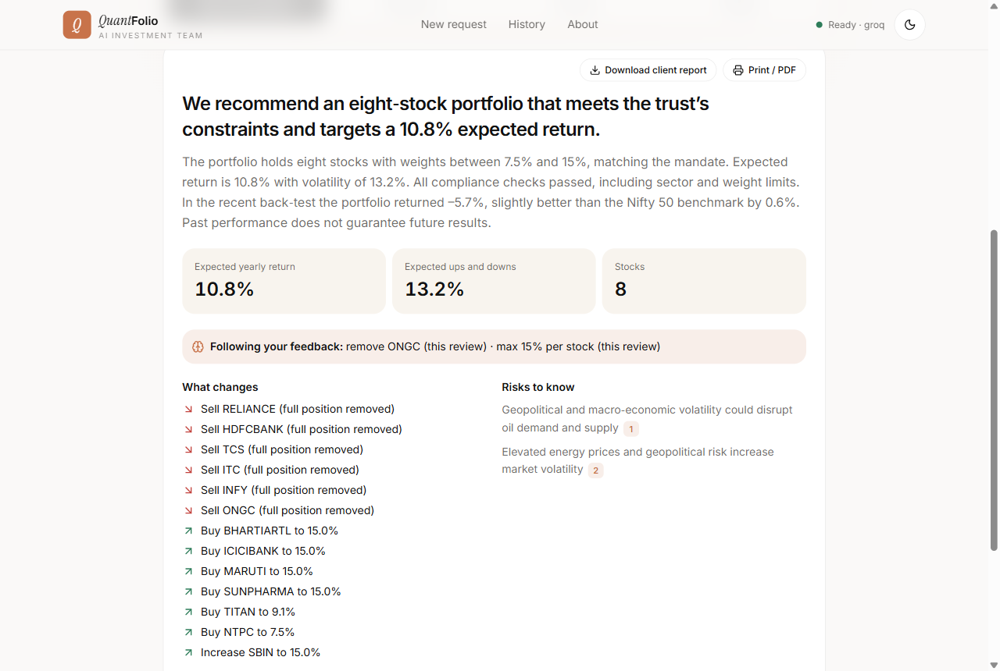
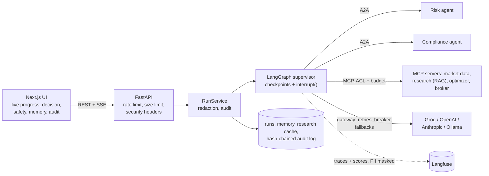
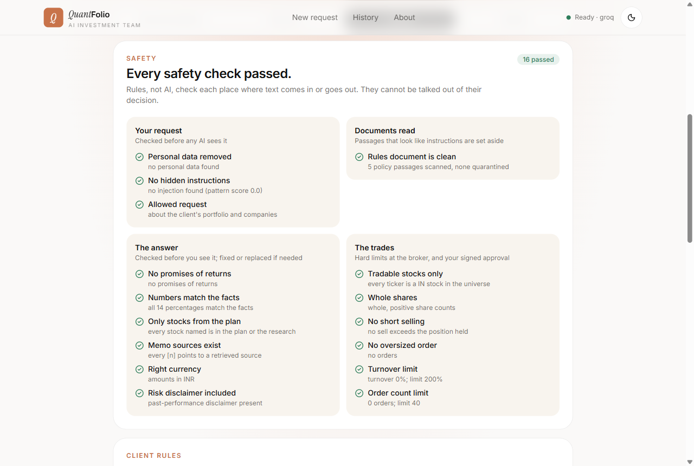

# QuantFolio Agents

**An AI investment team for advisors in the US and India.** A LangGraph supervisor coordinates
agents that research companies from their own regulatory disclosures (hybrid RAG), read each
client's investment policy, choose the best portfolio under its rules, and write a cited memo
and research report. A full harness surrounds the models:

* **guardrails** on every input and output;
* **four memory layers**;
* **self-correction**;
* **human approval** that is cryptographically bound to the exact orders;
* a **tamper-evident audit log**;
* **Langfuse tracing** and **RAGAS evaluation**.

Every setting, from chunk size to the guardrail thresholds, is chosen and checked on labelled
test sets.

| Start here | |
|---|---|
| Deploy | [docs/DEPLOY.md](docs/DEPLOY.md): Vercel + Render + Neon, Docker |
| Plain English | [docs/GUIDE.md](docs/GUIDE.md) · visual guide [docs/quantfolio-guide.html](docs/quantfolio-guide.html) (one file, open in a browser) |
| How it is built | [docs/ARCHITECTURE.md](docs/ARCHITECTURE.md): every layer, design decisions, failure modes |
| Numbers | [docs/evaluation.md](docs/evaluation.md) · [experiments/results/REPORT.md](experiments/results/REPORT.md) |
| Presenting it | [docs/EXPLAIN.md](docs/EXPLAIN.md): pitch, demo script, interview questions |
| Tracing | [docs/langfuse.md](docs/langfuse.md) |


---

## The business problem

Every quarter, advisors rebalance each client's portfolio. They read company reports, apply the
client's policy (how many stocks, caps per stock and per sector, exclusions, a risk limit),
choose what to buy and sell, check every rule, explain the change, and get sign-off. It is
repetitive, rule-bound and audited. QuantFolio Agents does the routine in about 20 seconds and
leaves the decision to the person:

1. **Safety check**: personal data is removed; hidden instructions and forbidden requests
   (insider trading, manipulation, promised returns) are stopped before any model sees them.
2. **Intake** understands the request and **recalls memory**: past reviews, learned preferences,
   the advisor's writing notes.
3. **In parallel**:
   * the **research agent** writes a cited research report from SEC 10-K filings (US) or SEBI
     annual reports and BRSR (India);
   * the **risk agent** (A2A service) measures risk;
   * the **compliance agent** (A2A service) turns the client's policy into rules, each linked to
     its sentence.
4. The **optimizer** scores every combination of allowed stocks and keeps the best (12,870
   combinations for 8 of 16), next to a rule-of-thumb baseline.
5. The plan is **backtested on unseen months**, **checked rule by rule**, and explained in a
   **memo that is checked before it is shown**: numbers, stocks, citations, no promises. A
   failed check gets one rewrite, then a safe template.
6. **You decide.** The decision box explains the plan first: what you asked, each client rule
   with a tick, and why each stock was chosen (return, steadiness, spread across sectors, what
   the research found), with a reason on every sell. Then Approve (a signed, single-use token
   for these exact orders), Change (re-plan now, remember for next time), or Reject.

### Your own clients

**Add a client** opens a form: who the client is, the market, the goal, current cash and shares,
and the rules (number of stocks, caps per stock and per sector, risk limit, excluded sectors and
companies, notes). The answers become an **investment policy document** in the same format as
the demo clients, shown live while you type, with plain warnings when the rules cannot work
("8 stocks of at most 10% cannot add up to 100%"). The new policy is added to the search index
on the spot, and the compliance agent reads it with RAG exactly like the others. Nothing is
special-cased for new clients. The notes are screened like any other input: personal data is
removed and hidden instructions are refused. A note can never loosen a limit.



### Two markets, two sets of research criteria

| | United States (20 stocks) | India (18 NSE stocks) |
|---|---|---|
| Regulator | SEC | SEBI |
| Research documents | Form 10-K Item 1A (risk factors), Item 7 (MD&A), XBRL facts | Annual report MD&A (SEBI LODR Reg. 34) and its risk paragraphs; BRSR; reported financials in ₹ crore |
| Prices, currency, benchmark | Yahoo Finance, USD, S&P 500 | Yahoo Finance (NSE), INR, Nifty 50 |
| Example clients | 3 mandates (C-101..C-103), plus any you add | Sharma Family Trust (C-201): 8 stocks, no tobacco, plus any you add |

## Architecture



| Layer | In one line | Pattern |
|---|---|---|
| Orchestration | deterministic supervisor, parallel superstep, durable pause for approval | LangGraph, orchestrator-workers |
| Tools | 4 MCP servers, per-agent allow-list, tool-call budget | Model Context Protocol |
| Inter-agent | risk and compliance agents publish Agent Cards, take JSON-RPC tasks, join the same trace | A2A 1.0 |
| Retrieval | BM25 + dense + RRF + cross-encoder, metadata filters, one search per company, citation gate, research cache | hybrid RAG |
| Guardrails | input, retrieval, memory, output and action rails; two-stage injection detection | NeMo rail types, OWASP LLM Top 10 (2025) |
| Self-correction | failed check -> one revision with the findings -> deterministic fallback | evaluator-optimizer |
| Memory | working, episodic, semantic, procedural; forget per client | CoALA taxonomy |
| Reliability | jittered retries, circuit breaker, idempotent broker, atomic decisions, bounded loops | backoff + jitter, circuit breaker |
| Observability | one trace per run, numbered sections, 23 score configs | Langfuse |
| Evaluation | online scores per run; offline datasets, red team, sweeps | RAGAS, Langfuse experiments |

Full explanation, request lifecycle, decisions and failure modes:
[docs/ARCHITECTURE.md](docs/ARCHITECTURE.md).

## What makes it trustworthy

* **Grounded research.** Answers come only from retrieved passages, and every sentence cites
  [n]. A cross-encoder checks each cited claim against its passage (calibrated threshold). Key
  numbers per company are computed from the filings' facts, never written by the model.
* **Guardrails as code.**
  * Personal data (PAN, Aadhaar, phone, email, cards, SSN, bank accounts) is redacted before
    storage, models and traces.
  * Prompt injection is caught by weighted patterns and by meaning (embedding similarity);
    poisoned report passages are quarantined.
  * The memo's numbers must match the computed facts.
* **Actions do not trust the model.**
  * Orders pass hard broker limits.
  * Orders need an HMAC-signed token bound to the reviewer, the client and the exact orders.
    It is single use and expires.
  * One approval can resume a run only once, even under concurrent requests.
* **Everything is recorded.** A hash-chained audit log (who started, stopped, changed,
  approved, executed) and a Langfuse trace per run.



## Results

All numbers come from `experiments/results/` (regenerate with `uv run python scripts/run_evals.py`).

**Retrieval** (78 labelled questions, US and India, top 6 over all chunks, no filters):

| Mode | hit rate@6 | MRR@6 | US risk (reworded) | India risk (reworded) |
|---|---|---|---|---|
| BM25 (keyword) | 85.9% | 0.743 | 44.4% | 90% |
| Dense (bge-small) | 94.9% | 0.808 | **83.3%** | 100% |
| Hybrid (RRF) | 92.3% | 0.817 | 66.7% | 100% |
| **Hybrid + rerank** (default) | **94.9%** | **0.901** | 77.8% | **100%** |

Facts and policy questions are found by every mode (100%, dense 97%). On reworded risk questions
keyword search fails most often. The reranker puts the right passage first most often (MRR 0.90).
Answer faithfulness judged by RAGAS (`qwen/qwen3.8-27b`, 8 answers) is **0.92**. It was 0.79
before the chunking fix described in [docs/evaluation.md](docs/evaluation.md).

**RAG configuration** (`scripts/tune_rag.py`, staged sweep on the same questions): 1100-character chunks beat 500 and 800. bge-base and the query
instruction did not improve the reranked result over bge-small. MiniLM-L-12 found one more of 78
questions but ranked worse (MRR) at twice the latency, so MiniLM-L-6 stays, with 40 candidates,
rerank depth 20 and top 6.

**Guardrails red team** (`scripts/eval_guardrails.py`):

| Test set | attacks stopped | normal requests allowed |
|---|---|---|
| Written with the rules (30 attacks, 20 normal) | 100% | 100% |
| Held-out set 1 (unseen, 15) | 70% (patterns alone: 60%) | 80% |
| Held-out set 2 (unseen, 15) | 87.5% (patterns alone: 50%) | 100% |

Personal data removed: 100% of 8 cases, and 5 clean texts untouched. 200 real report passages
with planted instructions: 100% set aside, and 100% of the clean ones kept. The second stage
(meaning) is calibrated at similarity 0.706 on normal requests.

**Citation gate** (`scripts/calibrate_citations.py`): threshold 1.24 (cross-encoder score), calibrated on 279 claim-passage
pairs. It accepts 95% of correctly cited claims and rejects 94% of claims checked against another
passage of the same company and 100% of claims against an unrelated passage.

**Agents** (rule-based mode, no LLM key): the compliance agent extracts every rule of all 4
mandates correctly (`output_rule_extraction_accuracy` = 1.0), every recommended portfolio passes
every rule, and excluded sectors and companies never appear.

## Quick start

Requirements: Python 3.11 with [uv](https://docs.astral.sh/uv/), Node 20+.

```bash
git clone https://github.com/pavanipavani16423-ctrl/QuantFolio-Agents.git
cd QuantFolio-Agents
uv sync
cp .env.example .env          # optional: GROQ_API_KEY, Langfuse keys

uv run uvicorn app.main:app --port 8000          # API + hosted A2A agents
cd web && npm install && npm run dev            # UI on http://localhost:3000
```

Without keys everything runs offline on rule-based fallbacks (and says so in the UI). Docker:
`docker compose up --build` (Postgres, API, two A2A agent services, UI).

## Deployment

| Part | Where | How |
|---|---|---|
| UI (`web/`) | **Vercel** | Root Directory `web`, `NEXT_PUBLIC_API_URL` = the API address |
| API + A2A agents | **Render** | Docker web service from `render.yaml` (Blueprint); models and index baked into the image |
| Database | **Neon** Postgres | `DATABASE_URL` as Neon shows it |

The database holds everything that must survive a redeploy: runs, memory, the audit log, the
LangGraph checkpoints (a plan waiting for approval), the paper-broker ledger and the clients
you add. Without `DATABASE_URL` the same code uses SQLite files. Step by step:
[docs/DEPLOY.md](docs/DEPLOY.md).

CI (`.github/workflows/ci.yml`) runs on every push:
* lint, then every test twice, on SQLite and on Postgres;
* type-check, lint and build of the web app;
* a build of the Docker image, which is started and checked on `/health`.

Evaluations:

```bash
uv run python scripts/run_evals.py         # guardrails, citation gate, RAG -> experiments/results/REPORT.md
uv run python scripts/run_evals.py --tune  # + the RAG configuration sweep (slow)
uv run pytest                              # 96 tests, offline
```

## Configuration

All settings are environment variables (or `.env`); see [.env.example](.env.example) and
`app/config.py`.

| Variable | Default | Meaning |
|---|---|---|
| `LLM_PROVIDER` | `mock` | `groq`, `openai`, `anthropic`, `ollama`, or `mock` (offline rules) |
| `LLM_MODEL` / `JUDGE_MODEL` | Groq: `openai/gpt-oss-120b` / `qwen/qwen3.8-27b` | agents / RAGAS judge |
| `LANGFUSE_PUBLIC_KEY`, `LANGFUSE_SECRET_KEY`, `LANGFUSE_BASE_URL` | - | tracing and scores |
| `EMBEDDING_MODEL`, `RERANKER_MODEL`, `CHUNK_TARGET_CHARS`, `RAG_TOP_K`, `RAG_CANDIDATES`, `RAG_RERANK_TOP` | tuned values | retrieval (see `scripts/tune_rag.py`) |
| `GUARDRAILS_ENABLED`, `SEMANTIC_INJECTION_THRESHOLD`, `CITATION_SUPPORT_THRESHOLD` | on, calibrated | guardrails |
| `APPROVAL_SECRET`, `APPROVAL_TTL_SECONDS` | local file, 900 | approval tokens |
| `MAX_ORDER_FRACTION`, `MAX_TURNOVER`, `MAX_TOOL_CALLS_PER_RUN` | 0.35, 2.0, 120 | action limits |
| `RATE_LIMIT_RUNS`, `RATE_LIMIT_WINDOW_SECONDS`, `API_KEY` | 12 / 600 s, - | API protection |
| `RESEARCH_CACHE_ENABLED`, `MEMORY_EPISODES_RECALLED` | on, 3 | memory |
| `DATABASE_URL` | SQLite files in `data/` | Postgres (Neon) URL as copied: runs, memory, audit, checkpoints, broker, added clients |
| `CORS_ORIGINS`, `CORS_ORIGIN_REGEX` | localhost:3000 | the Vercel address (and its preview pattern) |
| `MCP_TRANSPORT`, `A2A_RISK_URL`, `A2A_COMPLIANCE_URL`, `PUBLIC_BASE_URL` | in-process, hosted, Render's address | deployment |

## API

| Method | Path | |
|---|---|---|
| GET | `/health` | LLM, judge, Langfuse, index status |
| GET | `/api/v1/clients` · `/clients/{id}/rules` · `/clients/{id}/account` · `/clients/{id}/memory` | clients, their rules with quotes, paper accounts, memory by layer |
| POST | `/api/v1/clients/preview` · `/api/v1/clients` | preview the policy document and its problems / add a client |
| DELETE | `/api/v1/clients/{id}` | remove an added client (past runs and the audit log stay) |
| DELETE | `/api/v1/clients/{id}/memory` · `/clients/{id}/preferences/{pid}` | forget a client / one preference |
| POST | `/api/v1/runs` | start a run `{client_id, request}` (rate limited) |
| GET | `/api/v1/runs` · `/runs/{id}` · `/runs/{id}/events` (SSE) | runs and live progress |
| POST | `/api/v1/runs/{id}/approval` | `{action: approve/change/reject, reviewer, note, changes, remember}` |
| GET | `/api/v1/runs/{id}/audit` · `/audit/verify` | audit entries and chain check |
| GET | `/api/v1/chunks/{id}` · `/mandates/{client_id}` | citation viewer |
| GET | `/api/v1/system` · `/evaluations` | live architecture, latest evaluation results |
| GET/POST | `/a2a/{risk,compliance}/.well-known/agent-card.json` · `/a2a/*/rpc` | A2A agents (RPC needs the API key when set) |

## Project layout

```text
app/
  graph/ agents/ a2a/ mcp/      orchestration, agents, A2A services, MCP hub + servers
  rag/                          chunking, hybrid index
  guardrails/ security/         rails (input, injection, pii, scope, output, citations), approvals, HTTP
  memory/ reliability.py        memory manager; retries, circuit breaker
  quant/ evaluation/            portfolio maths, backtest; online RAGAS + checks
  observability/ services/      Langfuse tracer + score configs; run service
  api/ db/                      FastAPI routes, SQLAlchemy storage (runs, memory, audit)
web/                            Next.js 16 UI
scripts/                        fetch_data, fetch_india, eval_rag, eval_guardrails, tune_rag,
                                calibrate_citations, run_evals, build_guide
data/                           prices, SEC + NSE documents, mandates, accounts, eval sets, index
docs/                           GUIDE, ARCHITECTURE, EXPLAIN, evaluation, langfuse, visual guide
tests/                          unit + end-to-end (offline)
```

## Data

* **Prices**: daily closes for 20 US and 18 NSE large caps plus the S&P 500 and Nifty 50, from
  Yahoo Finance.
* **Documents**: 135 documents, 2,900 chunks. Latest 10-K Item 1A / Item 7 and XBRL facts from
  SEC EDGAR; the latest NSE annual report of each Indian company (MD&A, risk paragraphs, BRSR),
  parsed from the PDF (`scripts/fetch_india.py`; Titan's BRSR is published separately and NTPC
  uses FY2024-25 because the newest PDF is damaged).
* **Clients**: four synthetic investment policy statements and paper accounts, plus the ones you
  add (stored in `data/clients/`, git-ignored). No real client data.

## Limitations

* **Not investment advice**: paper trading, a small fixed universe, buy-and-hold backtests
  without costs, a short out-of-sample window.
* **Guardrails are strong but not complete**: perfect on the cases they were written for, lower
  on held-out attacks (see Results). The signed approval and the broker limits do not depend on
  them.
* Expected returns come from about two years of history (shrunk toward the average); standard but
  noisy.
* The cross-encoder runs on CPU (about 1-2 s per search).
