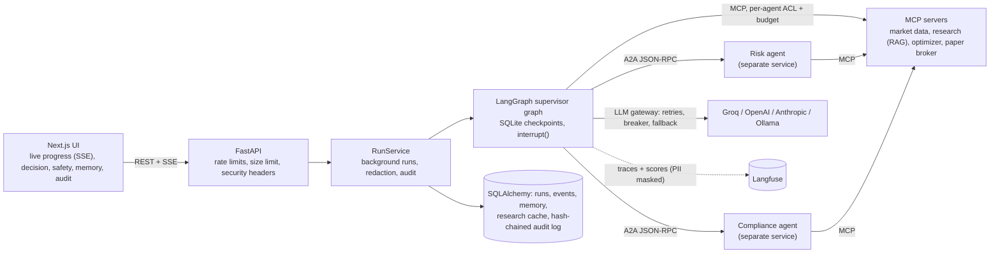
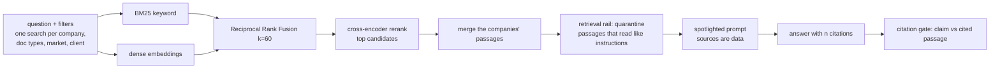

# Architecture: the AI harness, layer by layer

This document explains how QuantFolio Agents is built and why: every layer around the language
model (the "harness"), the path of one request through the system, the design decisions and
their trade-offs, and what happens when something fails. Plain-English overview:
[GUIDE.md](GUIDE.md). Numbers: [evaluation.md](evaluation.md).

---

## 1. The problem

Advisors rebalance client portfolios every quarter: read company disclosures, apply each
client's investment policy (number of stocks, position and sector caps, exclusions, a risk
limit), choose the stocks, check every rule, explain the change, and get sign-off. The work is
repetitive, rule-bound and audited, which makes it a good fit for agents, and a bad fit for an
unguarded chatbot: a wrong number, an invented citation or an unapproved trade is a compliance
incident. The design goal is therefore **useful automation with every step checked, cited,
approved and recorded**.

## 2. System context



## 3. The harness at a glance

| Layer | What it does | Code | Pattern it follows |
|---|---|---|---|
| Orchestration | Supervisor routes work; parallel steps; durable pause for a person | `app/graph/`, `app/agents/supervisor.py` | LangGraph supervisor (hub and spoke), orchestrator-workers |
| Agents + LLM gateway | Structured outputs with validated schemas; deterministic fallbacks | `app/agents/`, `app/llm/gateway.py` | Typed tool/JSON output, graceful degradation |
| Tools | Data and computation behind MCP servers, least privilege per agent | `app/mcp/` | Model Context Protocol |
| Inter-agent | Remote agents publish Agent Cards and take tasks | `app/a2a/` | A2A protocol 1.0 |
| Retrieval | Hybrid BM25 + dense + RRF + cross-encoder; filters; citations | `app/rag/`, `app/agents/research.py` | Hybrid RAG with reranking, contextual chunk headers |
| Guardrails | Input, retrieval, memory, output and action rails | `app/guardrails/` | NeMo Guardrails rail types, OWASP LLM Top 10 (2025) |
| Self-correction | A failed check gets one revision with the reasons, then a safe fallback | `research.py`, `report.py` | Evaluator-optimizer loop |
| Memory | Working, episodic, semantic, procedural; research cache | `app/memory/`, `app/db/` | CoALA memory taxonomy (LangGraph store, Letta/MemGPT) |
| Human in the loop | Approve / Change / Reject; learning; signed approval | `nodes.approval_node`, `app/security/approvals.py` | Interrupt + resume, capability token |
| Reliability | Timeouts, jittered retries, circuit breaker, idempotency, budgets | `app/reliability.py`, `mcp/hub.py`, `a2a/common.py` | Exponential backoff with jitter, circuit breaker |
| Security | PII redaction, rate limits, headers, audit chain | `app/security/`, `app/guardrails/pii.py` | Defence in depth |
| Observability | One trace per run, numbered sections, 23 score configs | `app/observability/` | Langfuse (OpenTelemetry) |
| Evaluation | Online scores per run; offline datasets and experiments | `app/evaluation/`, `scripts/eval_*.py` | RAGAS, Langfuse datasets + experiments |

## 4. One request, end to end

```mermaid
sequenceDiagram
    participant U as Advisor (UI)
    participant RS as RunService
    participant S as Supervisor
    participant G as Input guardrails
    participant I as Intake + memory
    participant R as Research (RAG)
    participant K as Risk (A2A)
    participant C as Compliance (A2A)
    participant O as Optimizer
    participant W as Report writer
    participant T as Trader / broker
    U->>RS: POST /runs {client, request}
    RS->>RS: rate limit, redact personal data, audit "run_started"
    RS->>S: start graph (thread = run id)
    S->>G: patterns + meaning + scope policy
    alt request not allowed
        G-->>U: status "blocked" with the reason (no agent or model ran)
    end
    S->>I: understand request, recall episodic / semantic / procedural memory
    par one LangGraph superstep
        S->>R: retrieve, quarantine poisoned passages, answer with [n], citation gate, revise once
    and
        S->>K: market-risk-profile
    and
        S->>C: extract-mandate-rules (RAG over the client's policy, sanity-checked)
    end
    S->>O: exact search over every k-subset (+ baseline), mean-variance weights
    S->>O: backtest on unseen months
    S->>C: check-portfolio (+ risk check); re-optimize once if only the volatility limit fails
    S->>W: memo from computed facts, output rails, revise once or use the template
    S->>S: deterministic scores now, RAGAS in the background
    S->>T: preview orders + broker order limits
    T-->>U: interrupt(): waiting for a decision (checkpointed)
    U->>RS: approve / change / reject
    alt change
        RS->>S: resume, revision + 1, re-plan from the optimizer
    else approve
        S->>S: issue signed single-use approval token, audit, remember episode
        S->>T: execute_orders(token) - broker verifies token and limits again
    end
```

## 5. Orchestration (LangGraph)

* **Supervisor hub, one spoke per agent** (`app/graph/workflow.py`). The supervisor
  (`app/agents/supervisor.py`) is a pure function of the state: given what is present it
  returns the next node(s) and a reason. Routing is deterministic on purpose: every run is
  reproducible, every decision is explainable (the reasons are in the UI and the trace), and the
  routing is unit-tested without a model. The LLMs do language work; control flow stays in code.
* **State** (`app/graph/state.py`) is a typed dict. Parallel branches write different keys;
  list keys (`guardrails`, `decisions`, `a2a_calls`) merge with an `add` reducer. Each node
  returns only the keys it owns.
* **Parallelism**: research, risk and mandate run in one superstep (returned together by the
  supervisor).
* **Human in the loop**: `approval_node` calls `interrupt()`. With the `AsyncSqliteSaver`
  checkpointer the run pauses durably; `POST /runs/{id}/approval` resumes it with
  `Command(resume=decision)`. A run waiting for approval survives a server restart.
* **Re-planning**: "Change" clears the proposal keys (optimization, backtest, checks, memo,
  evaluation, trades), increments `revision`, and the supervisor routes back to the optimizer
  with the advisor's change applied. Findings and background scores are tagged with the
  revision, so stale results are never shown for the new plan.
* **Loops are bounded**: one re-optimization on a volatility failure; one revision per writer;
  `recursion_limit` 80; a run timeout; a tool-call budget.

## 6. Agents and the LLM gateway

* Every model call goes through `LLMGateway.structured()` (`app/llm/gateway.py`): a Pydantic
  schema, tool-calling first, then JSON mode with the schema in the prompt (some models name
  the tool wrongly), jittered backoff between attempts, and a deterministic **fallback** for
  every agent (extractive answer, template memo, pattern-based rule extraction). The method that
  produced each output (`llm`, `rules`, `rules_after_guardrail`, `memory`, ...) is recorded and
  shown; nothing is silently invented.
* **Offline mode** (`LLM_PROVIDER=mock`): every agent runs on its fallback, so the whole system,
  including the tests, runs without a key.
* **Models** (Groq free tier): agents `openai/gpt-oss-120b` (low reasoning effort); the RAGAS
  judge `qwen/qwen3.8-27b`, a different model so that per-model rate limits do not compete.
* **Untrusted model output is never executed**: rule values from the compliance LLM are
  sanity-checked against pattern extraction and the stricter value wins; tickers must exist in
  the client's market; weights come from the optimizer, not from text.

## 7. Tools (MCP) and remote agents (A2A)

* **Four MCP servers** (`app/mcp/servers/`): market data, research (RAG), optimizer, paper
  broker. In-process (`InMemoryTransport`, a full MCP session over memory streams) by default,
  or stdio subprocesses (`MCP_TRANSPORT=stdio`).
* **Least privilege**: `AGENT_TOOL_ACL` in `app/mcp/hub.py` lists the tools each agent may call
  (the research agent cannot trade). A denied call is recorded and raises.
* **Budget**: a run may make at most `MAX_TOOL_CALLS_PER_RUN` tool calls (unbounded-consumption
  guard). Servers also cap their own inputs (problem size, order count).
* **A2A**: the risk and compliance agents are separate services with Agent Cards
  (`/a2a/{name}/.well-known/agent-card.json`) and JSON-RPC endpoints. The caller passes its
  Langfuse trace id in the message metadata, so remote spans join the same trace. Transient
  failures (read timeouts, 5xx) are retried with backoff; if the network service is unreachable
  the same protocol runs against the in-process ASGI app.

## 8. Retrieval (hybrid RAG)



* **Corpus**: 135 documents, 2,900 chunks: SEC 10-K Item 1A and Item 7 plus XBRL facts for 20
  US companies; for 18 NSE companies the annual report's MD&A (SEBI LODR Reg. 34), risk
  paragraphs and BRSR, parsed from NSE PDFs; 4 client policy statements.
* **Chunking**: paragraph packing to a target size, never across a section heading, never
  mid-sentence; a contextual header ("NVIDIA Corporation (NVDA) 10-K Item 1A risk factors -
  <section>") is indexed with each chunk. The Indian reports are PDF text with line breaks in
  the middle of sentences, so they are reflowed first: a line counts as a heading only if it
  stands alone (the text before it ended a sentence, it does not end on "of" or "the", the next
  line starts a new sentence). Before this fix 18% of all chunks were fragments under 120
  characters ("in building the Nilaya brand as a top"), and one company's only BRSR passage in a
  live run was its "Source: ..." line. Chunks under 300 characters are merged into a neighbour.
* **One search per company**: a question about TCS, HDFC Bank and Hindustan Unilever runs three
  filtered searches and merges them (about `rag_top_k` passages in total, at least two each for
  up to three companies). A single search over all three let the best-covered company take four
  of six passages.
* **Companies named in the request are always researched**: the intake model's ticker list is
  merged with a deterministic name matcher (a live run dropped HDFC Bank from the model's list).
* **Settings chosen by measurement** (`scripts/tune_rag.py`, results in
  [evaluation.md](evaluation.md)): chunk size, embedding model and query instruction, reranker,
  candidate pool, rerank depth and top-k, each tested on the 78 labelled questions. Relevance is
  judged by text anchors, so chunkings can be compared fairly.
* **Metadata filters** before scoring (market, tickers, document types, client), so a US client
  never retrieves Indian passages and a client's mandate is invisible to other clients.
* **Citation gate** (`app/guardrails/citations.py`): every sentence with [n] is scored against
  its cited passage by the cross-encoder; the threshold is calibrated
  (`scripts/calibrate_citations.py`) so that 95% of true claims pass while most claims checked
  against another passage of the same company fail.
* **The research report**: an executive summary, one section per company (key points and risks,
  every sentence cited), and what the sources do not cover (uncited: a passage may only be cited
  for what it says, so "the report does not discuss dividends [6]" fails the citation gate); key numbers per company (revenue,
  operating income, net income, growth, margin) are computed in code from the facts documents
  (`app/agents/figures.py`), never written by the model. The UI renders it as a report that can
  be downloaded (Markdown) or printed to PDF, and the memo + research make a client report.
* **Research cache**: answers that passed every check are cached by (market, companies, index
  version) and matched by embedding similarity; a near-identical question reuses the checked
  answer.

## 9. Guardrails

| Rail | Checks | On failure |
|---|---|---|
| Input (`input.py`, `pii.py`, `injection.py`, `semantic.py`, `scope.py`) | personal data (US + India formats, Luhn for cards); prompt injection by weighted patterns over a normalised text (Unicode NFKC, zero-width characters removed, spaced letters joined), then by embedding similarity to attack intents; scope policy (insider trading, manipulation, financial crime, promised returns, off-topic) | PII is redacted before storage, models and traces; injection or policy -> run stopped before any agent |
| Retrieval (`research.quarantine`, compliance agent) | instruction-like passages in reports and policy documents (indirect injection) | passage kept out of the prompt and out of rule extraction, listed in the run |
| Memory (`memory/manager.screen_note`) | advisor notes before they are stored or reused as guidance | not kept / not reused |
| Output (`output.py`, `citations.py`) | research: source numbers exist, coverage, support, no promises; memo: numbers grounded in the facts, only known tickers of the market, citations exist, currency, no promises, disclaimer | one revision with the findings; then extractive answer / template memo; a missing disclaimer is added |
| Action (`broker.order_limits`, `approvals.py`) | known tickers of the client's market, whole shares, no short selling, max order size, turnover, order count; signed token for exactly these orders | no approval possible / execution refused |

Guardrails are **code, not prompts**: fast, deterministic, unit-tested and impossible to argue
with. The semantic stage adds recall on paraphrased attacks; its threshold is calibrated on
benign requests only. Each finding is stored with its layer, step and revision, shown in the UI
("Safety" in the Checks tab), and summarised as Langfuse scores.

**OWASP Top 10 for LLM Applications (2025)**

| Risk | Control here |
|---|---|
| LLM01 Prompt injection | input rail (two-stage), retrieval rail, spotlighting, memory screening |
| LLM02 Sensitive information disclosure | PII redaction before storage, models and Langfuse (mask function); the approval token never enters the run document |
| LLM03 Supply chain | pinned dependencies (`uv.lock`), local ONNX models, no remote code |
| LLM04 Data and model poisoning | quarantine of instruction-like passages; memory written only from human decisions |
| LLM05 Improper output handling | output rails; weights and orders come from code, not text; broker validation |
| LLM06 Excessive agency | per-agent tool ACL, tool budget, signed single-use approval bound to the orders |
| LLM07 System prompt leakage | prompt-extraction requests blocked; no secrets in prompts |
| LLM08 Vector and embedding weaknesses | per-client and per-market retrieval filters |
| LLM09 Misinformation | citations required and verified; numbers grounded; RAGAS faithfulness |
| LLM10 Unbounded consumption | body size limit, rate limit, tool-call budget, run timeout, bounded loops, circuit breaker |

## 10. Memory

| Layer (CoALA) | Holds | Store | Written | Read |
|---|---|---|---|---|
| Working | the run's state | LangGraph checkpoint | every step | every step |
| Episodic | past reviews: outcome, stocks, note | `episodes` | approve / change / reject | intake (last 3) -> memo "previous reviews" |
| Semantic | removed stocks, caps, lower risk | `client_preferences` | "Change" with remember | intake -> `effective_rules` (only tighten) |
| Procedural | advisor notes on how to write for the client | `client_preferences` (note) | decision note, if safe | intake -> memo "advisor guidance" |
| Research cache | checked answers | `research_cache` | research step | research step (similarity >= threshold) |

Hygiene: memory comes only from human decisions; notes are screened for injection and PII both
on write and on read; preferences can only make the mandate stricter; `DELETE
/clients/{id}/memory` forgets a client (the audit log keeps the decisions).

## 11. Human in the loop and learning

* The decision is a typed request: `approve | change | reject`, reviewer, note, structured
  changes (remove tickers, max weight, lower risk), remember.
* **Change** re-plans in the same run; **remember** stores the change as semantic memory and
  the note as procedural memory. The next run applies them from the first proposal.
* **Approve** issues an HMAC-SHA256 token binding run, client, reviewer, a hash of the exact
  orders and an expiry. The broker verifies it, refuses a different order list or client, and
  records the token id so a retry never trades twice.
* Learning is measured: `human_approved`, `human_revisions`, `learned_preferences_applied`,
  `memory_items_recalled` per trace.
* **Before the buttons, the plan explains itself** (`web/components/run/why.tsx`). It shows:
  * the question as the intake agent understood it;
  * each client rule, ticked against the chosen portfolio;
  * per stock, the reasons taken from the numbers the optimizer used: top third for expected
    return, bottom third for volatility, the only stock of its sector, asked about by you,
    risks found in the research;
  * a reason on every sell (not allowed, removed by you, trimmed, not in the best combination);
  * the companies you asked about that are not in the plan, and why.

  Nothing in it is written by a model.

**Adding a client** (`app/data/clients.py`): the form's answers are validated for feasibility
(enough companies left after the exclusions, caps that can add up to 100%, sector limits that
can be met) and screened (PII redacted, injection patterns and meaning). They are then written
up as an investment policy statement in the same phrasing as the demo policies. The policy is
embedded on top of the cached index and swapped in as a new index object, so searches in flight
see one consistent index. From then on the client goes through the normal path, with nothing
special-cased: the compliance agent retrieves the policy with RAG and extracts its rules with
citations. A test checks the round trip: form, then document, then the same rules back. The form
limits come before the free-text notes in the document, and the compliance agent keeps the
stricter value, so a note cannot loosen a limit. Client ids are never reused, so old runs and
audit entries stay unambiguous after a client is removed.

## 12. Reliability

| Failure | Handling |
|---|---|
| LLM error, timeout, malformed output | tool call -> JSON mode with jittered backoff -> deterministic fallback; reported per call |
| LLM provider down | circuit breaker per model opens after 4 consecutive failures for 60 s; calls go straight to the fallback |
| Rate limits (HTTP 429) | the provider SDK retries with Retry-After (`LLM_MAX_RETRIES`) |
| A2A service slow or 5xx | 3 attempts with backoff; unreachable -> in-process transport |
| MCP transport error | one retry; tool error -> raised to the step (the run fails visibly) |
| Duplicate execute | broker keyed by the approval token id: replay returns the earlier fills; the replay check, account update and execution record are one SQLite `BEGIN IMMEDIATE` transaction |
| Two approvals at once | a per-run lock plus an atomic status compare-and-set in the database: only one decision resumes a paused run, even across processes |
| Learned exclusions leave too few stocks | the optimizer drops remembered exclusions first, then this review's, records a warning, and still plans |
| Server restart | a run waiting for approval resumes from the checkpoint; runs that were executing are marked failed |
| "Change" while RAGAS still scores | the stale background task is cancelled; merges check the revision |
| Runaway work | bounded loops, tool budget, run timeout, concurrency semaphore |

## 13. Security summary

API key (optional) on `/api/v1` and on the A2A JSON-RPC endpoints (Agent Cards stay public);
CORS allow-list; chunked request bodies refused (the size limit needs Content-Length); per-address rate limit on new runs; request
size limit; security headers (ASGI middleware, SSE-safe); secrets only in `.env`; PII redaction;
signed approvals; tamper-evident audit log (`audit_log`: each row stores the previous row's hash
and its own; `GET /audit/verify` recomputes the chain).

## 14. Observability

One Langfuse trace per run, sections numbered in run order (guardrail, agent, retriever, tool,
evaluator and generation types), remote A2A spans in the same trace, a resumed run joins the
same trace. 23 score configs: RAG (`rag_*`), output (`output_*`), portfolio (`portfolio_*`),
guardrails and self-correction (`guardrail_*`, `self_corrections`), memory (`memory_*`,
`research_cache_hit`) and human decisions (`human_*`). A mask function removes personal data
from every input, output and metadata field before export. Details: [langfuse.md](langfuse.md).

## 15. Evaluation harness

| | What | Where |
|---|---|---|
| Online, every run | deterministic checks immediately; RAGAS (faithfulness, answer relevancy, context precision and relevance, memo rubric) in the background; all as Langfuse scores | `app/evaluation/online.py` |
| Retrieval | 78 labelled questions (US + India), 4 modes, hit rate / MRR / recall / RAGAS ID metrics; LLM-judged faithfulness on a sample | `scripts/eval_rag.py` |
| RAG configuration | staged sweep of chunk size, embedding model, reranker, depth | `scripts/tune_rag.py` |
| Guardrails | red team: 30 attacks + 20 tricky benign requests, PII cases, 200 real passages clean vs poisoned; two held-out sets never used for tuning | `scripts/eval_guardrails.py` |
| Citation gate | threshold calibration on supported claims vs hard negatives | `scripts/calibrate_citations.py` |
| Everything | runs the above and writes `experiments/results/REPORT.md` | `scripts/run_evals.py` |
| Code | 74 unit and end-to-end tests, offline | `tests/` |

Methodology notes: the test sets were not used to tune the retrieval defaults; held-out
guardrail cases are reported separately from the cases written with the rules (a detector
always looks perfect on its own examples); every number in the docs comes from a JSON file in
`experiments/results/`.

## 16. Design decisions and trade-offs

| Decision | Why | Trade-off |
|---|---|---|
| Deterministic supervisor, LLMs only for language | reproducible, testable, explainable control flow | less "autonomous"; new routes need code |
| Rules for guardrails, plus an embedding stage | precise, fast, auditable; the second stage adds recall on paraphrases | rules need maintenance; neither stage is complete, so actions are protected independently |
| Exact search for stock selection | at 16-20 candidates every combination can be scored, so the answer is proven optimal | exponential in n; above the limit a local search is used and flagged |
| Separate judge model | per-model rate limits; a model does not grade itself | two model configs |
| RAGAS in the background | the advisor decides in ~20 s instead of ~3 min | scores arrive after the decision box |
| Signed approval token at the broker | the trade boundary does not trust any agent | a key to manage (`APPROVAL_SECRET`) |
| SQLite by default | zero setup; Postgres via `DATABASE_URL` | single-node by default |
| In-memory rate limiter | simple, no extra service | per process; use a shared store when scaled out |
| Local ONNX models (fastembed) | no embedding API, no data leaves the machine | CPU latency for the reranker (~1-2 s per search) |

## 17. Deployment and scaling path

**Deployed today** ([DEPLOY.md](DEPLOY.md)): the UI on Vercel; the API with the hosted A2A
agents as one Docker web service on Render; Postgres on Neon. One `DATABASE_URL` switches every
store from SQLite to Postgres:

| Store | SQLite (laptop) | Postgres (cloud) |
|---|---|---|
| runs, events, memory, cache, audit | SQLAlchemy + aiosqlite | SQLAlchemy + asyncpg |
| LangGraph checkpoints | `AsyncSqliteSaver` | `AsyncPostgresSaver` on a checked connection pool |
| paper-broker ledger | `BEGIN IMMEDIATE` | transaction-scoped advisory lock per client |
| added clients | JSON + policy files | one row per client (soft delete, ids never reused) |

Neon's libpq URL is converted per driver (`app/db/urls.py`). Prepared statements are off, so
Neon's PgBouncer endpoint works. Connections are checked before use, because Neon suspends idle
databases.

The image bakes in the models and the index, so a container is stateless. CI runs the whole test
suite on both databases and builds and starts the image.

**Next:**
* a shared rate-limit store (Redis) for more than one API instance;
* the A2A agents and MCP servers as separate services (already supported by URL and transport
  settings; `docker-compose.yml` runs the agents that way);
* pgvector once the corpus outgrows in-memory NumPy;
* a hosted reranker or a GPU;
* a queue for background scoring.

## 18. Code map

```text
app/
  graph/          LangGraph state, nodes, workflow, run context (steps -> trace + UI events)
  agents/         intake, research, optimizer, report, preferences, supervisor
  a2a/            risk + compliance agents (A2A servers), client with retries and fallback
  mcp/            hub (ACL, budget, tracing, retries) + servers: market_data, research, optimizer, broker
  rag/            chunking, hybrid index (BM25, dense, RRF, rerank)
  guardrails/     input, pii, injection, semantic, scope, output, citations
  memory/         memory manager (episodic, semantic, procedural, research cache)
  security/       approval tokens, HTTP hardening, OWASP mapping
  reliability.py  backoff, retry, circuit breaker
  quant/          statistics, selection + weights, backtest
  evaluation/     online RAGAS + checks, judge adapters
  observability/  Langfuse tracer (masking), score configs
  services/       run service (background runs, SSE, approval resume, redaction, audit)
  api/ db/        FastAPI routes, SQLAlchemy storage
web/              Next.js 16 UI
scripts/          data fetching, evaluations, tuning, calibration, guide builder
tests/            unit + end-to-end
```
